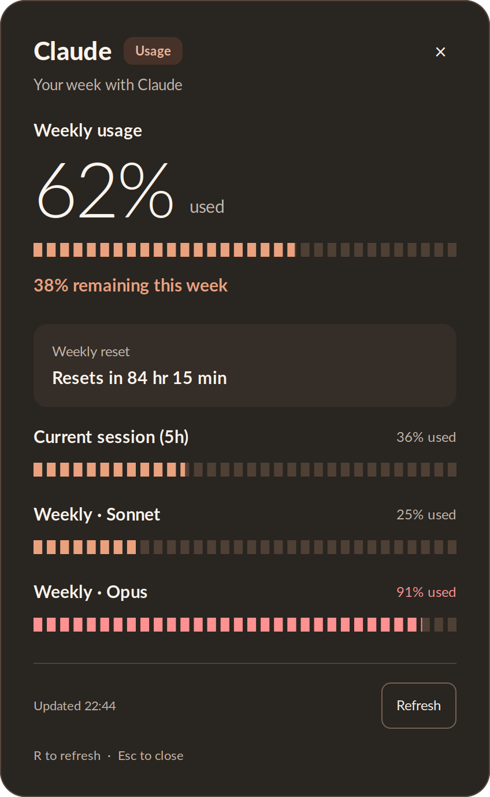

# Claude Usage Widget

[](https://github.com/musel25/claude-usage-widget/actions/workflows/checks.yml)
[](LICENSE)

A small Linux desktop widget and terminal CLI that show your **claude.ai** usage
limits — current 5-hour session and weekly limits per model — by reading the
same `/api/organizations/<org_id>/usage` endpoint that the
[claude.ai usage page](https://claude.ai/settings/usage) uses.

Three ways to view your usage:

| Tool | Command | Output |
|------|---------|--------|
| `claude_usage_cli.py` | `uv run python claude_usage_cli.py` | Color terminal dashboard |
| `claude_usage_widget.py` | `uv run python claude_usage_widget.py` | GTK3 GUI window |
| `claude_usage.sh` | `bash claude_usage.sh` | Raw JSON (for debugging) |

## Why this exists

There's no official API for the consumer claude.ai usage page, and the in-app
view requires opening the browser. This pulls the same data using your logged-in
session cookies and renders it locally — terminal or GUI — so you can check
your remaining quota at a glance.

## Requirements

- [uv](https://docs.astral.sh/uv/) for the Python environment

- Linux (tested on Ubuntu/GNOME; Wayland and X11 both work)
- Python 3.9+
- `curl` on `PATH`
- For the GUI widget only: **GTK3** and **PyGObject**

Install GTK3 + PyGObject via your package manager (these are system packages,
not pip):

```bash
# Debian / Ubuntu
sudo apt install python3-gi python3-gi-cairo gir1.2-gtk-3.0 curl

# Fedora
sudo dnf install python3-gobject gtk3 curl

# Arch
sudo pacman -S python-gobject gtk3 curl
```

The CLI (`claude_usage_cli.py`) only uses the Python standard library, so it
works without any extra packages.

## Setup

```bash
git clone https://github.com/musel25/claude-usage-widget.git
cd claude-usage-widget
uv venv --python /usr/bin/python3 --system-site-packages
uv sync
cp config.env.example config.env
# then edit config.env with your credentials — see next section
```

## Getting your credentials

`config.env` needs three values: `ORG_ID`, `SESSION_KEY`, `CF_CLEARANCE`. You
grab all three from a logged-in claude.ai browser session.

1. Sign in to <https://claude.ai> in your browser.
2. Open <https://claude.ai/settings/usage>.
3. Open DevTools → **Network** tab. Reload the page.
4. Find the request to `/api/organizations/<org_id>/usage`. Right-click it →
   **Copy → Copy as cURL**.
5. From that curl command, fill in `config.env`:

   - `ORG_ID` — the UUID in the URL between `/organizations/` and `/usage`.
   - `SESSION_KEY` — the `sessionKey=...` value in the `-b` (cookie) flag.
   - `CF_CLEARANCE` — the `cf_clearance=...` value in the same `-b` flag.

> **This is the only thing that needs maintenance.** `cf_clearance` and
> `sessionKey` expire periodically (typically every couple of weeks). When the
> widget starts erroring, repeat steps 1–5 and paste the new cookie values into
> `config.env`. `ORG_ID` never changes for the same account.

`config.env` is gitignored, so your credentials won't accidentally be committed.

## Usage

### Terminal dashboard

```bash
uv run python claude_usage_cli.py
```

Optional: add a shell alias for one-letter access. Append to `~/.zshrc` or
`~/.bashrc`:

```sh
alias cu='/usr/bin/python3 /absolute/path/to/claude-usage-widget/claude_usage_cli.py'
```

### GUI widget

A rounded warm charcoal panel with terracotta accents with a large weekly percentage, segmented usage meters,
remaining quota, and a reset card shares a layout with the companion Codex widget. Session
and per-model limits stay visible below. Use **Refresh** (or **R**) to update
and **×** (or **Esc**) to close. Failed refreshes retain available usage with
a stale indicator; hover over the status for the error details.



```bash
uv run python claude_usage_widget.py
```

Behavior is controlled by `WIDGET_MODE` in `config.env`:

- **`popup`** *(default)* — centered, undecorated, closes on `Esc` or when it
  loses focus. Best paired with a global hotkey (see "Hotkey" below).
- **`desktop`** — undecorated and pinned to the bottom-left corner; behaves
  like a desktop widget. Good for autostart.
- **`window`** — a normal floating window with title bar, kept above other
  windows.

`AUTO_CLOSE_SECONDS` auto-dismisses the widget after N seconds (set to `0` to
disable).

The widget caches the last successful response under
`~/.cache/claude-usage-widget/usage.json` so it can paint immediately on launch
while a fresh fetch runs in the background.

### Raw JSON

```bash
bash claude_usage.sh
```

Pipes the API response through `jq` if installed. Useful for debugging or
seeing fields that the CLI/GUI don't render.

## Optional integrations

### Autostart on login

Copy the example desktop entry, fill in your install path, and drop it into
`~/.config/autostart/`:

```bash
cp claude-usage-widget.desktop.example ~/.config/autostart/claude-usage-widget.desktop
# then edit that file and replace <INSTALL_DIR> with your absolute path
```

Pair this with `WIDGET_MODE="desktop"` for a permanent corner widget.

### Global hotkey (GNOME, popup mode)

Bind a shortcut like `Super+Shift+U` in **Settings → Keyboard → Custom
Shortcuts** to:

```
/usr/bin/python3 /absolute/path/to/claude-usage-widget/claude_usage_widget.py
```

With `WIDGET_MODE="popup"` and `AUTO_CLOSE_SECONDS="4"`, this gives you a
HUD-style usage check that fades on its own.

## File overview

| File | Purpose |
|------|---------|
| `claude_usage_core.py` | Shared fetch / parse / cache logic |
| `claude_usage_cli.py` | Terminal dashboard (truecolor ANSI) |
| `claude_usage_widget.py` | GTK3 GUI (popup / desktop / window modes) |
| `claude_usage.sh` | Raw JSON dump via `curl` + `jq` |
| `config.env.example` | Template for credentials and config |
| `claude-usage-widget.desktop.example` | Template for autostart entry |

## Notes & caveats

- **Unofficial.** This relies on a private claude.ai endpoint and on browser
  session cookies. Anthropic could change either at any time.
- **Don't share `config.env`.** `SESSION_KEY` is equivalent to a logged-in
  session for your account.
- The neutral "Usage" badge does not assume a subscription plan. Quotas come
  from the API response.

## License

[MIT](LICENSE). Unofficial; not affiliated with or endorsed by Anthropic.

## Contributing and companion widget

See [CONTRIBUTING.md](CONTRIBUTING.md) for offline tests, a credential-free
preview, and contribution guidelines. Screenshots above use synthetic data.

Also available: [Codex Usage Widget](https://github.com/musel25/codex-usage-widget).
The two widgets share a layout but keep separate installations and authentication.
